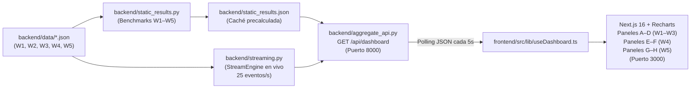

# Guía Completa: Workshops 4, 5 y Funcionamiento del Dashboard
> **Universidad de Antioquia · Lógica y Representación III (2026-2) · Equipo 4**  
> **Proyecto:** *Video Streaming Platform – Content Moderation* (Workshops 1, 2, 3, 4 y 5)

---

## 1. Arquitectura General del Sistema

El proyecto integra los **5 workshops** en una sola aplicación dividida en dos capas desacopladas:



### Cómo fluyen los datos
1. **Cálculo estático (`backend/static_results.py`):** ejecuta una sola vez todos los experimentos reproducibles (`seed = 42`) de W1, W2, W3, W4 y W5, genera los datasets JSON de W4 y W5 en `backend/data/`, y guarda el resumen consolidado en `backend/static_results.json`.
2. **Motor en vivo (`backend/streaming.py`):** mantiene un cursor temporal sobre el stream de 10 000 videos (`videos_workshop2_equipo4.json`) que avanza a 25 eventos/segundo. Cada petición a `/api/dashboard` devuelve la ventana móvil actual de 1 000 videos, los momentos $F_0, F_1, F_2$, las alertas de *Spam Wave*, el Filtro de Bloom acumulado y la consulta ad-hoc de HyperLogLog del día actual.
3. **API unificada (`backend/aggregate_api.py`):** sirve `GET /api/dashboard` (y `GET /api/dashboard?pos=N` para auditar una posición fija) además de `GET /health`. Combina la caché estática con el estado en vivo del stream en un único payload JSON de ~115 KB.
4. **Frontend reactivo (`frontend/src/`):** el hook `useDashboard(5000)` consulta la API cada 5 segundos y actualiza automáticamente los 8 paneles del dashboard sin recargar la página. Si el backend se desconecta, conserva el último estado válido y muestra un aviso en pantalla.

---

## 2. Explicación del Workshop 4 (MapReduce y Eficiencia Paralela)

**Módulo principal:** `backend/algorithms/mapreduce.py`  
**Datasets generados:**
- `backend/data/fragments_w4/part_00.jsonl` … `part_07.jsonl` (8 fragmentos JSONL para ejecución Map paralela).
- `backend/data/transiciones_mapreduce_workshop4_equipo4.json` (grafo de 100 aristas construido por MapReduce sobre 100 000 subidas).
- `backend/data/node_summary_workshop4_equipo4.json` (resumen de las 10 categorías con `out_transition_count`, `in_transition_count`, `net_flow`, `flagged_frac` y `avg_view_count_1h`).

### Evolución del escenario
En la Unidad 3 el grafo de transiciones entre categorías cabía en memoria. En el **Workshop 4** el volumen escala a **100 000+ subidas** repartidas en **$\ge 8$ archivos fragmento** y procesadas con un motor MapReduce paralelo (`MapReduceRunner` sobre `ProcessPoolExecutor` con $\ge 2$ procesos reales).

### Desglose por tarea (W4)

1. **Task 1 — Pipeline MapReduce (Job 1 + Job 2) y validación contra Unidad 3:**
   - **Job 1a (Secuenciación por uploader):** cada worker Map lee un fragmento JSONL y emite `(uploader_id, (stream_seq, category, is_flagged, view_count_1h))`. Reduce agrupa por `uploader_id`, ordena por `stream_seq` y emite cada transición consecutiva `((from_category, to_category), (1, is_flagged, view_count_1h))`.
   - **Job 1b (Suma de aristas):** consolida las transiciones por par `(from_category, to_category)` usando un **Combiner** local por mapper para reducir el tráfico de red.
   - **Job 2 (Node Summary):** a partir de las aristas emite salidas (`from_category`) y entradas (`to_category`), calculando `out_transition_count`, `in_transition_count`, `net_flow = in - out`, `flagged_frac` y `avg_view_count_1h`. Se verifica la conservación de flujo ($\sum \text{net\_flow} = 0$).
   - **Validación contra Unidad 3:** al ejecutar Job 1 sobre los 10 000 registros de W2 divididos en 8 fragmentos, reproduce las **100 aristas de W3 con 0 discrepancias** en `transition_count`, diferencia máxima $2.78 \times 10^{-17}$ en `flagged_frac` y $0.0$ en `avg_view_count_1h`.

2. **Task 2 — S10: PageRank Iterativo Matriz-Vector en MapReduce:**
   - En cada iteración, Map emite `(j, p(i,j) · v_i)` por cada arista $(i \to j)$ y Reduce suma todas las contribuciones entrantes a $j$ aplicando amortiguamiento $v_{\text{new}}[j] = d \sum_i p(i,j) v_i + (1-d)/N$ con $d = 0.85$.
   - Converge en **7 iteraciones** ($100 \text{ pares/iter} \times 7 = 700$ pares totales) con error máximo **$2.51 \times 10^{-14} \ll 10^{-4}$** frente al PageRank de Unidad 3.

3. **Task 3 — Análisis de Costo (Combiner, Escalamiento 1x/2x/4x $\to$ 10x y S10):**
   - Se ejecuta el pipeline completo a **1x (100 000)**, **2x (200 000)** y **4x (400 000)** subidas comparando **sin combiner** vs. **con combiner**, verificando crecimiento estrictamente lineal ($R^2 = 1.00000$) y extrapolando a **10x (1 000 000)**.
   - El combiner colapsa el tráfico de agregación (Job 1b + Job 2) de $O(\text{transiciones})$ a $O(M \cdot |C|^2) = 800$ pares (**−99,1% a −99,9%** en agregación y **−45,5% a −45,8%** en bytes totales del pipeline), al que se suma el costo S10 (700 pares).

4. **Task 4 — Tamaño de Reducer ($q$) y Tasa de Replicación ($r$):**
   - Reporta $(r, q)$ para Job 1a ($r=1.0$), Job 1b con combiner ($r=0.0084$), Job 2 ($r=2.0$ antes de combiner porque cada arista emite origen y destino) y S10 ($r=1.0$).
   - Identifica la clave caliente de Job 1: el uploader más activo `USER_00000` ($q_{\text{hot}} = 659$ uploads).
   - Ejecuta Job 1 con **$R \in \{1, 2, 4, 8\}$ reducers**, mostrando cómo la carga máxima cae de **100 000** ($R=1$) a **13 056** ($R=8$) manteniendo un balance cercano a $1.04\times$.

5. **Task 5 — S14: Clave Caliente Sesgada (Ola de Spam $\ge 40\%$) + Mitigación:**
   - Inyecta una ola de spam donde **45%** de 120 000 subidas caen en `Noticias`.
   - **Sin mitigación ($P = 1, 2, 4, 8$):** un único reducer rezagado (*straggler*) recibe toda la categoría caliente; en $P=8$ el *Load Balance Factor* sube a **5,06×**, el speedup se estanca en **1,20×** y la eficiencia paralela cae a **15,0%**.
   - **Con mitigación (Salting en $P$ cubetas + Combiner local):** la carga se reparte equitativamente (LBF = **1,00×**, reducción de **−80,3%**), el tráfico shuffle cae **99,47%**, el tiempo en $P=8$ baja de **966,8 ms a 277,3 ms** (**3,49× más rápido** y **4,19×** frente a la línea base $P=1$) y la eficiencia casi se triplica (**42,9%**).

---

## 3. Explicación del Workshop 5 (Búsqueda de Similitud, Shingling, MinHash y LSH)

**Módulo principal:** `backend/algorithms/similarity.py`  
**Dataset generado:** `backend/data/uploaders_workshop5_equipo4.json` (1 000 uploaders con `category_sequence`, `seq_length`, `flagged_frac`, `avg_view_count_1h`, `shingle_count`, `minhash_signature` de longitud 100, `occupancy_vector` de 12 dimensiones y `neighbors` Top-5 por Jaccard).

### Evolución del escenario
El equipo de *Trust & Safety* necesita detectar **cuentas coordinadas** que siguen patrones de publicación casi idénticos a una cuenta marcada, evitando el costo cuadrático de comparar los $\binom{1000}{2} = 499.500 \approx 500.000$ pares totales. El dataset de 1 000 uploaders contiene **10 clusters sembrados** (7 anillos coordinados maliciosos con alta tasa de marcados + 3 redes benignas) y 880 cuentas de fondo.

### Desglose por tarea (W5)

1. **Task 1 — Representaciones, Distribuciones (5 000 pares), Correlación con LCS (500 pares) y Concentración de Distancias:**
   - **Conjuntos:** $k=3$ shingles consecutivos de `category_sequence` (captura el orden local de transiciones).
   - **Vectores (12D):** proporciones de las 10 categorías + 2 métricas estandarizadas (`z_seq_length`, `z_log_view_count_1h`). **`flagged_frac` queda excluido explícitamente** del vector para evitar fuga de datos (*data leakage*) en el Outcome Test.
   - Se calculan distribuciones de **Jaccard, Coseno, L1 y L2** sobre **5 000 pares aleatorios**.
   - Sobre **500 pares**, se correlacionan Jaccard, Coseno y **similitud LCS** (subsecuencia común más larga normalizada): Jaccard–LCS muestra la correlación más alta ($r = 0.943$, $\rho = 0.752$), mientras que Coseno mide proporciones globales independientemente del orden ($r \approx 0.42$).
   - **Concentración de distancias:** al pasar de 2D ($\text{CV}_{L2} = 0.503$) a 10D ($\text{CV}_{L2} = 0.256$), el contraste relativo entre distancias cercanas y lejanas cae a la mitad.

2. **Task 2 — Hiperplanos Aleatorios (Charikar) y Cosine LSH:**
   - Genera firmas binarias $\text{bit}_i(v) = \mathbb{I}(v \cdot r_i \ge 0)$ con **$n \in \{16, 32, 64, 128\}$** hiperplanos normales aleatorios.
   - Verifica el teorema de Charikar ($\text{fracción de bits iguales} \approx 1 - \theta/180^\circ$) en **1 000 pares**: el error angular medio (MAE) desciende de **16,61°** ($n=16$) a **5,58°** ($n=128$).
   - Aplica *banding* Cosine LSH y evalúa **50 consultas** frente a fuerza bruta: con $n=128$ $(b=16, r=8)$ obtiene **100% de recall@5** ahorrando **64,4%** de las comparaciones.

3. **Task 3 — S21: $k$-Shingles Consecutivos ($k = 2, 3, 4$):**
   - Compara tamaño promedio del conjunto, shingles posibles ($10^k$) vs. observados y separación de clusters sembrados (Jaccard intra-cluster vs. inter-cluster):
     - $k=2$: 100/100 posibles, intra `0,786` vs. inter `0,148` (margen `+0,638`, demasiadas colisiones de fondo).
     - **$k=3$ (elegido):** 1 000/1 000 posibles, tamaño medio `57,9`, intra `0,700` vs. inter `0,018` (**mayor margen `+0,682`**, ratio `38,9×`).
     - $k=4$: 9 836/10 000 posibles, intra `0,652` vs. inter `0,002` (margen `+0,650`, demasiado sensible a mutaciones).

4. **Task 4 — S25: Diseño de Umbral con MinHash ($n=100$) en el Runner MapReduce de Unidad 4:**
   - El cálculo de las 100 firmas MinHash se ejecuta como tarea **Map** sobre el `MapReduceRunner` de Unidad 4 (4 workers, 8 fragmentos) y el agrupamiento de bandas LSH se ejecuta en **Reduce**.
   - Para encontrar pares con $s \ge 0.6$ garantizando $\text{FNR}(s=0.8) = (1 - 0.8^r)^b \le 1\%$, se selecciona **$(b = 20, r = 5)$**:
     - Umbral de inflexión $t = (1/20)^{1/5} = 0.549$, $P(s=0.6) = 80,2\%$, $\text{FNR}_{\text{teór}}(0.8) = 0,036\% \le 1\%$.
     - **Validación contra fuerza bruta (499 500 pares):** genera solo **650 pares candidatos** (**99,87% de ahorro**), con **92,3% de precisión**, **94,0% de recall** sobre los 638 pares reales con $s \ge 0.6$ y **0,00% de FNR empírico** para $s \ge 0.8$.

5. **Task 5 — Comparación Top-5 Vecinos (24 Consultas) y Outcome Test (`flagged_frac`):**
   - Para 24 cuentas consulta compara los Top-5 vecinos de **MinHash/LSH**, **Cosine LSH** y **LCS** (evaluado únicamente sobre los candidatos LSH), reportando `overlap@5` (30,8%–40,0%) y explicando los desacuerdos según la sensibilidad de cada métrica al orden secuencial.
   - **Outcome Test (`flagged_frac` fuera del vector):** los Top-5 vecinos MinHash/LSH de cuentas marcadas ($\ge 25\%$) tienen una tasa media de marcados de **42,57%** (73,0% de vecinos marcados) frente a **14,06%** en 5 uploaders aleatorios (**lift = 3,03×**, $z = 14,20$, $p = 8,69 \times 10^{-46}$).

---

## 4. Cómo Funciona Todo el Dashboard (Guía Panel por Panel)

Al abrir `http://localhost:3000`, el encabezado superior ofrece tres controles globales:
- **Filtro de Unidades:** `Todos (A–H)` · `W1–W3 (A–D)` · `W4 MapReduce (E–F)` · `W5 Similitud & LSH (G–H)` para mostrar todo el proyecto o enfocarse en un workshop durante la exposición.
- **Botón `Big Data Context (W1 T1)`:** despliega el banner con la estimación de subidas/s y almacenamiento de metadatos ante un crecimiento de usuarios $10\times$.
- **Indicador de conexión en vivo:** muestra un punto verde pulsante con la hora de la última actualización automática cada 5 segundos.

### Resumen de los 8 Paneles (A–H)

| Panel | Workshop | Componente React | Qué muestra y qué controles interactivos tiene |
| :---: | :---: |---|---|
| **A** | **W1** | `BucketDistributionChart.tsx` | **Hashing y Colas de Moderación.** Pestañas: *Tabla Hash (T4)* (histograma Chaining vs. Power of Two Choices con selector de $n$ y $m$) y *Sharding Revisores (T3)* (carga por worker entre 32 revisores). |
| **B** | **W1** | `RuntimeChart.tsx` | **QuickSort Aleatorizado vs. Determinista.** Selector de escenario (*Ordenado*, *Inverso*, *Aleatorio*) y casilla de *Escala log* para visualizar la aceleración de ~253× en el peor caso. |
| **C** | **W2** | `LiveMetricsPanel.tsx` | **Streaming en Tiempo Real.** Avanza en vivo con el cursor del flujo. Incluye barra de alerta de *Spam Wave* ($z\text{-score}(F_2) > 2$) + resumen de Chernoff (W1 T5), y 3 pestañas: *Ventana 1000 & $F_k$* (con selector de bits del Filtro de Bloom 4/8/12/16), *HyperLogLog (T4)* y *Reservoir Sampling (T3)*. |
| **D** | **W3** | `PageRankPanel.tsx` | **Grafos, Markov y 2-SAT.** 3 pestañas: *PageRank Overlay* (radar comparando PageRank, frecuencia bruta y `flagged_frac`), *Cadena DTMC & $\pi$ (T1–T4)* (clasificación de estados + tabla de caminata perezosa 50k pasos) y *Políticas 2-SAT (T5)* (asignación booleana de Papadimitriou y verificación de las 5 cláusulas). |
| **E** | **W4** | `MapReducePanel.tsx` | **MapReduce: Eficiencia Paralela & Shuffle.** 3 pestañas: *Speedup & S14 (T5)* (curvas de speedup y eficiencia para $P=1,2,4,8$ comparando ola de spam sesgada vs. Salting+Combiner), *Shuffle & Costo (T3)* (barras sin vs. con combiner en 1x, 2x, 4x y 10x extrapolado + costo S10) y *Reducers $q$ & $r$ (T4)* (carga máxima para $R=1,2,4,8$ y tabla de $(r, q)$ por job). |
| **F** | **W4** | `CategoryFlowPanel.tsx` | **Node Summary: Net Flow vs. Flagged Rate.** 2 pestañas: *Flujo Neto & Flag (T1/T6)* (scatter por cuadrantes identificando en rojo las categorías crecientes con alto flag: `Noticias` y `Salud`, junto a las tarjetas de validación exacta vs. U3) y *Validación S10 PageRank (T2)* (tabla comparativa categoría por categoría confirmando error $< 10^{-4}$). |
| **G** | **W5** | `SimilarityNeighborsPanel.tsx` | **Similitud & Top-5 Vecinos por Método.** 4 pestañas: *Top-5 Vecinos (T5)* (menú desplegable para escoger entre 24 uploaders y ver lado a lado sus Top-5 vecinos en MinHash/LSH, Cosine LSH y LCS con puntajes, candidatos examinados, `overlap@5` y `flagged_frac` de cada vecino), *Distancias (T1)* (histogramas de Jaccard/Cosine/L1/L2, correlaciones y tabla de concentración), *Hiperplanos (T2)* (dispersión ángulo real vs. estimado Charikar y tabla de recall@5) y *k-Shingles S21 (T3)* (barras intra vs. inter cluster para $k=2,3,4$). |
| **H** | **W5** | `LshThresholdOutcomePanel.tsx` | **Diseño de Umbral S25 & Outcome Test.** 2 pestañas: *S25 Umbral & P/R (T4)* (curva S de LSH para varios $(b, r)$ resaltando $(20, 5)$, barras de precisión/recall vs. fuerza bruta de 499 500 pares y tabla comparativa de FNR en $s=0.8$) y *Outcome Test `flagged_frac` (T5)* (gráfica de barras y tabla demostrando el lift de **3,03×** en la tasa de marcados de los vecinos de cuentas infractoras frente a 5 uploaders aleatorios). |

---

## 5. Comandos de Ejecución y Recálculo

```bash
# 1. Instalar dependencias de Python (solo la primera vez)
pip install -r requirements.txt

# 2. (Opcional) Recalcular desde cero static_results.json y datasets W4/W5
py backend/aggregate_api.py --refresh --serve 8000

# 3. Iniciar únicamente el backend usando la caché precalculada
py backend/aggregate_api.py --serve 8000

# 4. Iniciar el frontend en otra terminal
cd frontend
npm install
npm run dev
```

Abrir en el navegador: **`http://localhost:3000`**

