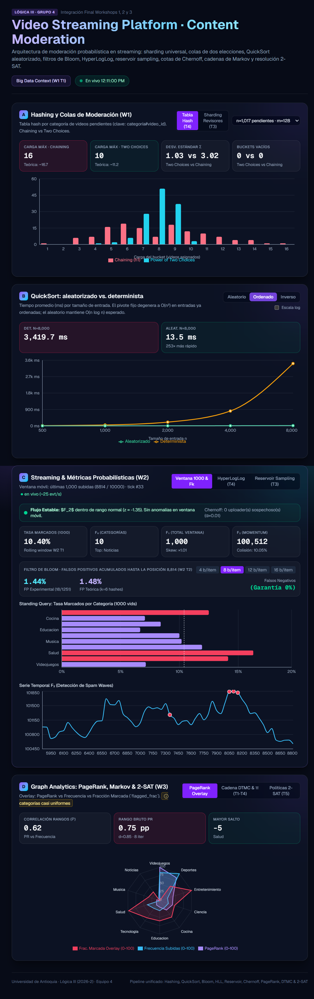

# UNIVERSIDAD DE ANTIOQUIA
### Facultad de Ingeniería
### Ingeniería de Sistemas
### Lógica y Representación III

  

## Práctica Workshops 1, 2 y 3
# Moderación de Contenido para una Plataforma de Streaming de Video
### *Video Streaming Platform – Content Moderation*

  

**Presentado por:**

**Andres Ferney Buitrago Suarez**  
**Arley Otalvaro Vasquez**  
**Juan Camilo Botero Ospina**  

 

**Equipo 4**

  

**Presentado a:**  
**WILLIAM ERNESTO CORNEJO SÁNCHEZ**

  

**Medellín, Colombia**  
**2026**

---

## 1. Link del repositorio

**Repositorio oficial del proyecto:**  
[https://github.com/AndresBuitrago-IA95/Video-Streaming-Platform-Content-Moderation.git](https://github.com/AndresBuitrago-IA95/Video-Streaming-Platform-Content-Moderation.git)

---

## 2. Resumen del escenario

El proyecto simula el sistema centralizado de moderación de contenido para una plataforma de streaming de video a escala masiva. En este entorno, creadores de contenido publican videos de forma continua a través de 10 categorías temáticas (*Ciencia, Cocina, Deportes, Educación, Entretenimiento, Música, Noticias, Salud, Tecnología y Videojuegos*). El sistema debe recibir las publicaciones, identificar material potencialmente infractor mediante reglas automatizadas, enrutar los videos reportados a colas de revisión humana y evaluar patrones anómalos o ataques coordinados de spam.

El dataset experimental base se compone de **10.000 registros de video** generados durante una ventana de observación de 24 horas, distribuidos entre **1.121 uploaders únicos**, y complementado por un flujo continuo simulado de **10.000 eventos de streaming** que incorpora métricas dinámicas de interacción (como `view_count_1h`).

Un servicio de streaming de producción genera un volumen de información que escala de manera vertiginosa. En la práctica resulta inviable almacenar todo el historial en memoria RAM o realizar barridos exhaustivos cada vez que se requiere tomar una decisión operativa en milisegundos (por ejemplo: *¿este creador ya tiene antecedentes de infracción?, ¿cuál es el volumen estimado de creadores activos hoy?, ¿cuál es la media de reproducciones por categoría sin recorrer millones de registros?, ¿está colapsando la cola de un revisor humano?*). Ante estas restricciones, el proyecto recurre a **algoritmos aleatorizados, probabilísticos y de streaming**: estructuras de datos sublineales (sketches) y técnicas que ofrecen garantías estadísticas sólidas y errores estrictamente acotados a cambio de una fracción mínima de consumo de memoria y tiempo respecto a las soluciones deterministas exactas.

Es fundamental destacar que los datos empleados son sintéticos y generados mediante un script determinista con semilla fija (`seed=42`), lo cual asegura la reproducibilidad íntegra de cada benchmark y facilita el contraste analítico frente a los teoremas y cotas formales, delimitando al mismo tiempo la generalización de ciertas conclusiones sobre la estocasticidad del tráfico humano real.

El informe y la solución tecnológica se estructuran en tres unidades fundamentales:
1. **Unidad 1:** Proyecciones de Big Data, ordenamiento aleatorizado (QuickSort), sharding balanceado y tablas hash probabilísticas (Chaining vs. Power of Two Choices), y control de significancia estadística mediante cotas de Chernoff sobre datos en lote (*batch*).
2. **Unidad 2:** Procesamiento de flujos continuos (*streams*) con memoria estrictamente acotada, detección de reincidentes con Filtros de Bloom, muestreo uniforme en flujo con Reservoir Sampling (Algoritmo R), estimación de cardinalidad con HyperLogLog y monitoreo de momentos de frecuencia ($F_0, F_1, F_2$) para detección de anomalías (*Spam Waves*).
3. **Unidad 3:** Modelado de la dinámica de navegación y transición entre categorías mediante cadenas de Markov discretas en tiempo (DTMC), convergencia a la distribución estacionaria ($\pi$), medición de centralidad con PageRank, verificación de ergodicidad con caminatas perezosas (*Lazy Random Walks*) y resolución de políticas de moderación operativa mediante el algoritmo probabilístico de Papadimitriou para 2-SAT.

---

## 3. Qué se midió

A lo largo de los tres workshops integrados se midieron y contrastaron empíricamente los siguientes indicadores:

- **Carga máxima por bucket y dispersión en tablas hash:** Carga máxima, desviación estándar ($\sigma$) y cantidad de buckets vacíos comparando encadenamiento simple (*Chaining*) frente a *Power of Two Choices* ($d=2$) sobre una tabla de 128 buckets para los 1.017 videos marcados para revisión.
- **Balanceo en sharding distribuido:** Asignación de 10.000 videos entre 32 revisores humanos utilizando funciones de hash universal, midiendo la carga media (312,5 videos), carga máxima (383 videos) y el ratio de desbalance ($\text{máx}/\text{media} = 1,23$).
- **Tiempo de ejecución y aceleración en ordenamiento (QuickSort):** Tiempos de respuesta (en milisegundos) y factor de aceleración (*speedup*) entre QuickSort determinista (pivote fijo al primer elemento) y QuickSort aleatorizado (pivote uniforme) sobre arreglos ordenados, inversos y aleatorios con tamaños de $n$ de 1.000 a 8.000 elementos.
- **Tasa de falsos positivos en Filtro de Bloom:** Porcentaje de falsos positivos empíricos frente a la predicción teórica para presupuestos de 4, 8, 12 y 16 bits por elemento sobre 1.190 consultas negativas (uploaders sin antecedentes), confirmando la ausencia de falsos negativos.
- **Error relativo medio en Reservoir Sampling:** Error porcentual absoluto en la estimación de la media de `view_count_1h` por categoría para tamaños de muestra $k \in \{100, 300, 500\}$ a través de 30 repeticiones independientes del Algoritmo R.
- **Error relativo y huella de memoria en HyperLogLog:** Error empírico de estimación de cardinalidad de uploaders únicos diarios frente a la cota asintótica teórica ($1,04/\sqrt{m}$) para $m \in \{16, 32, 64, 128\}$ registros, contrastado con el consumo de bits en memoria.
- **Concentración y anomalías en momentos de frecuencia:** Cálculo en tiempo real de los momentos $F_0$ (categorías activas), $F_1$ (total de eventos) y $F_2$ (repetibilidad/energía) en una ventana móvil de 1.000 eventos, con activación de alertas cuando $z\text{-score}(F_2) > 2$.
- **Convergencia y masa estacionaria en Cadenas de Markov:** Número de iteraciones hasta convergencia del vector $\pi$, magnitud del residuo numérico y discrepancia entre la categoría de máxima masa estacionaria y la categoría líder en frecuencia bruta.
- **Centralidad por PageRank vs. Frecuencia bruta:** Vector de PageRank ($d=0,85$) sobre el grafo dirigido de transiciones de categorías y correlación de ordenamiento de rangos de Spearman ($\rho$) respecto al conteo crudo de publicaciones.
- **Distancia de variación total en Caminata Perezosa:** Discrepancia empírica de una simulación de 50.000 pasos con probabilidad de retención $1/2$ respecto a la distribución teórica $\pi$.
- **Satisfacibilidad de políticas de moderación (2-SAT):** Número de iteraciones y cambios de variable (*flips*) requeridos por el algoritmo de Papadimitriou para encontrar una asignación válida sobre 8 variables booleanas sujetas a 5 restricciones operativas.

---

## 4. Teoría contra empírico

### Task 4. Tabla hash con clave categoría#video_id: Chaining vs. Power of Two Choices

**Qué se hizo.** Se implementó una tabla hash de 128 buckets para gestionar la cola de los 1.017 videos marcados (`is_flagged = True`) que demandan inspección prioritaria por parte de moderadores. Se empleó como clave la concatenación `categoría#video_id` y funciones de hash universal basadas en enteros aleatorios primos. Se compararon dos políticas de inserción:
1. *Chaining convencional:* El registro se indexa directamente en el bucket $h_1(\text{clave})$.
2. *Power of Two Choices ($d=2$):* Se evalúan dos posiciones hash independientes $h_1(\text{clave})$ y $h_2(\text{clave})$, insertando el registro en aquel bucket que contenga el menor número de elementos al momento de la inserción.

Se registraron la carga máxima por bucket, la desviación estándar de la distribución de carga y la presencia de buckets desocupados.

#### Resultados obtenidos:

| Métrica | Chaining | Two Choices ($d=2$) |
|---|:---:|:---:|
| **Carga máxima observada** | **16** | **10** |
| **Carga máxima teórica esperada** | 16,73 | 11,22 |
| **Desviación estándar ($\sigma$)** | 3,02 | 1,03 |
| **Buckets vacíos** | 0 | 0 |
| **Carga media por bucket ($\alpha = n/m$)** | 7,95 | 7,95 |
| **Reducción porcentual de carga máxima** | — | **−37,5 %** |
| **Reducción de desviación estándar** | — | **−65,9 %** |

**Teoría vs. resultados.** El análisis clásico de bolas y urnas (*balls into bins*) establece que cuando se distribuyen $n$ elementos en $m$ urnas con factor de carga $\alpha = n/m$ moderado ($\alpha \approx 7,95$), el encadenamiento simple genera una carga máxima esperada acotada por:
$$\mathbb{E}[\text{máx}] \approx \alpha + \sqrt{2\alpha \ln m}$$
Para $n=1.017$ y $m=128$, esta formulación arroja una cota teórica de **16,73**, coincidiendo estrechamente con el valor empírico de **16** obtenido en Chaining.

En contraposición, el teorema fundamental de Azar, Broder, Karlin y Upfal demuestra el "poder de dos elecciones": consultar dos opciones independientes reduce exponencialmente el exceso sobre el promedio a un término de la forma:
$$\mathbb{E}[\text{máx}] \approx \alpha + \frac{\ln(\ln m)}{\ln 2} + O(1)$$
La cota teórica ajustada para este caso es **11,22**. Los resultados empíricos reflejan con exactitud esta predicción, alcanzando una carga máxima de tan solo **10** elementos y reduciendo la dispersión ($\sigma$) de 3,02 a 1,03. Con Two Choices la carga se compacta de manera uniforme alrededor de la media (7,95), evitando que ningún revisor quede sobrecargado con una cola anormalmente extensa.

**Costo operativo.** La estrategia Power of Two Choices demanda evaluar dos funciones de hash y realizar dos consultas de longitud en memoria durante la inserción. En operaciones de búsqueda, si un elemento no está presente, deben explorarse ambas listas. Sin embargo, dado que la longitud de la cadena más larga se redujo en un 37,5% (de 16 a 10), el costo en el peor caso de una búsqueda con acierto disminuye de forma apreciable, ofreciendo un servicio mucho más predecible y homogéneo en sistemas concurrentes.

**Conclusión.** Con claves compuestas uniformes, Power of Two Choices aplana sustancialmente los picos de congestión sin penalizar la memoria, transformando una distribución con colas pesadas en una asignación casi determinista alrededor del valor esperado.

---

### Comparación y análisis de resultados entre algoritmos

Se evaluaron de manera cruzada los algoritmos probabilísticos y analíticos implementados a través de las tres unidades del proyecto bajo tres criterios rectores: exactitud de resultados, consumo de memoria y tiempo de cómputo, identificando su escenario de uso óptimo (Tabla 1).

| Algoritmo (Unidad, Task) | Resultado Principal | Consumo de Memoria | Tiempo de Cómputo | Destaca cuando |
|---|---|---|---|---|
| **QuickSort Aleatorizado** *(U1, T2)* | Speedup de **253,4×** en arreglo ordenado ($n=8.000$); tiempo idéntico en datos aleatorios. | $O(\log n)$ en la pila de llamadas. | $\approx 4,1\text{ ms}$ vs. $1.038\text{ ms}$ del pivote determinista. | El flujo de entrada puede llegar preordenado cronológicamente o con secuencias adversarias. |
| **Sharding Universal** *(U1, T3)* | Reparto equitativo de 10.000 videos en 32 revisores (media 312,5; máx 383; ratio 1,23). | $O(1)$ adicional (parámetros de función universal). | $O(1)$ por video insertado. | Se requiere enrutar trabajo de forma determinista y descentralizada sin locks de base de datos. |
| **Power of Two Choices** *(U1, T4)* | Reducción de carga máxima de **16 a 10** (−37,5%) y desviación estándar de **3,02 a 1,03** (−66%). | Idéntica a Chaining (128 punteros de cabecera). | Doble evaluación hash en inserción; búsqueda acotada por listas cortas. | Se busca evitar la inanición (*starvation*) y latencias atípicas en colas de atención crítica. |
| **Cotas de Chernoff** *(U1, T5)* | De 1.121 uploaders, 140 superan el umbral ($20,34\%$), pero **0 clasificados sospechosos** ($\alpha=0,01$). | $O(1)$ por uploader evaluado. | Microsegundos por evaluación analítica. | Se requiere distinguir varianza puramente aleatoria de dolo sistemático en cuentas de bajo volumen. |
| **Filtro de Bloom** *(U2, T2)* | Tasa de falsos positivos de **2,10%** con 8 bits/elem (teórico 2,16%) y **0%** con 16 bits. Cero falsos negativos. | $\approx 801\text{ bytes}$ para 801 uploaders reincidentes (8 bits/item). | $O(k)$ constante ($k=6$ hashes) en consulta e inserción. | Se necesita descartar instantáneamente si un creador no tiene reportes previos sin acceder a disco. |
| **Reservoir Sampling** *(U2, T3)* | Error de estimación medio de **15,57%**, **8,07%** y **6,51%** en reproducciones para $k=100, 300, 500$. | Estrictamente acotado a $k$ tuplas en RAM. | $O(1)$ por cada nuevo evento procesado del flujo. | El tamaño del stream es masivo o indefinido y no cabe en memoria para promedios acumulados. |
| **HyperLogLog** *(U2, T4)* | Estimación de uploaders únicos diarios con error de 17% a 34% usando entre **96 y 768 bits**. | 12 a 96 bytes de memoria fija (6 bits por registro). | $O(1)$ por elemento mediante operaciones binarias. | Se monitorean millones de identificadores únicos diarios en streaming con presupuesto de RAM insignificante. |
| **Momentos de Frecuencia** *(U2, T5)* | $F_0=10$, $F_1=10.000$, $F_2=10.005.406$. Alerta automática cuando $z\text{-score}(F_2) > 2$. | $O(C)$ dependiente del número de categorías ($C=10$). | $O(1)$ amortizado en ventana deslizante de 1.000 eventos. | Se monitorea la entropía del flujo para detectar ráfagas no coordinadas de spam en tiempo real. |
| **Cadena DTMC y Distribución $\pi$** *(U3, T1–T2)* | Convergencia en 9 iteraciones (residuo $6,4 \times 10^{-16}$). *Videojuegos* es pozo de atracción (10,57%). | Matriz estocástica de $10 \times 10$ ($100$ flotantes). | $< 1\text{ ms}$ en cálculo matricial iterativo. | Se analiza el comportamiento de navegación y permanencia a largo plazo de los usuarios. |
| **PageRank de Categorías** *(U3, T3)* | Ranking topológico ($d=0,85$); correlación de rangos Spearman $\rho = 0,62$ respecto al conteo bruto. | Matriz $10 \times 10$ más vector de centralidad. | Converge en 12 iteraciones con tolerancia $10^{-6}$. | Se requiere ponderar la influencia e interconexión temática entre categorías más allá del volumen bruto. |
| **Caminata Perezosa** *(U3, T4)* | Simulación de 50.000 pasos con distancia de variación total de solo **0,58%** respecto a $\pi$. | Un vector de 10 contadores enteros. | Lineal en el número de pasos ($O(N)$). | El grafo de transición pudiera presentar bipartición o periodicidad y se requiere forzar ergodicidad. |
| **Algoritmo 2-SAT (Papadimitriou)** *(U3, T5)* | Asignación satisfactoria encontrada en **1 solo intento y 1 flip** para 8 variables y 5 cláusulas. | $O(V)$ para estado de literales ($V=8$). | $O(V^2)$ pasos aleatorizados en valor esperado. | Se deben resolver dinámicamente políticas operativas y presupuestales en configuraciones críticas. |

*Tabla 1. Comparación integral de los algoritmos del proyecto en resultados, memoria, tiempo y situación de uso.*

---

**Resultados y exactitud.** Los algoritmos probabilísticos demostraron una excelente correspondencia con las expectativas teóricas. En hashing, *Power of Two Choices* redujo la carga máxima de 16 a 10 elementos. El *Filtro de Bloom* confirmó empíricamente que con 8 bits por elemento la tasa de falsos positivos se ubicó en 2,10% (frente al 2,16% formulado por la ecuación teórica de Carter-Wegman/Kirsch-Mitzenmacher), garantizando cero falsos negativos. En la estimación de medias con *Reservoir Sampling*, el error cayó de manera monótona a medida que $k$ aumentó de 100 a 500 (de 15,57% a 6,51%). En el análisis estructural de categorías, el PageRank expuso que la interconectividad entre tópicos presenta divergencias frente al volumen bruto de subidas ($\rho = 0,62$), demostrando que categorías con menos volumen pueden actuar como puentes estructurales de navegación.

**Memoria.** Es la dimensión donde los algoritmos probabilísticos y de streaming exhiben una ventaja incuestionable. *HyperLogLog* sintetiza la cardinalidad de uploaders con solo 768 bits (96 bytes para $m=128$), en contraste con los kilobytes que demandaría un conjunto Hash exacto en memoria. El *Filtro de Bloom* mantiene el registro de 801 infractores en apenas 800 bytes, y el *Reservoir Sampling* opera con una ventana fija de memoria sin importar si el stream procesa $10^4$ o $10^8$ eventos. El intercambio asumido es un margen de error pequeño y estadísticamente parametrizable.

**Tiempo de cómputo.** Con un dataset local de 10.000 elementos, las estructuras exactas no saturaron la memoria y sus tiempos fueron competitivos. No obstante, en QuickSort el beneficio del pivote aleatorizado fue drástico: al ordenar una lista previamente ordenada de 8.000 elementos, el pivote fijo degradó la complejidad a $O(n^2)$ tardando más de 1.000 ms, mientras que el pivote aleatorio mantuvo el comportamiento esperado $O(n \log n)$ resolviéndolo en 4,1 ms (**253,4× más rápido**). De igual modo, las consultas $O(1)$ de Bloom y las actualizaciones en streaming de los momentos $F_k$ se ejecutan a más de 25 eventos por segundo en tiempo real sin latencia perceptible.

**Cuándo conviene cada método.** Los enfoques deterministas exactos son idóneos cuando los datos caben cómodamente en memoria principal y se requiere exactitud contable o forense sin tolerancia a desviaciones. Por el contrario, los algoritmos aleatorizados y los *sketches* probabilísticos son indispensables en arquitecturas de Big Data y procesamiento de flujos masivos en tiempo real, donde almacenar o reescanear el historial colapsaría el rendimiento del sistema.

---

## 5. Capturas del panel de control

### Vista General: Hashing, Sharding y Runtimes de Ordenamiento

  
  
<em>Figura 1. Vista de los Paneles A y B del dashboard integrado. En el Panel A se observa la comparativa de distribución de carga en tabla hash (Chaining vs. Power of Two Choices), evidenciando el aplanamiento de la cola crítica, junto con las métricas de balanceo de carga entre 32 revisores humanos. En el Panel B se exhiben las curvas de tiempo de ejecución de QuickSort determinista frente al aleatorizado bajo entradas ordenadas, inversas y aleatorias.</em>

 

### Procesamiento de Streams en Tiempo Real: HyperLogLog y Filtro de Bloom

  
  
<em>Figura 2. Panel C del dashboard en ejecución en vivo. Se aprecia el monitoreo continuo de la ventana móvil de 1.000 eventos con el cálculo dinámico de los momentos de frecuencia F₀, F₁, F₂ y tasa de marcados. En la sección inferior se exhibe la evaluación de cardinalidad con HyperLogLog para m ∈ {16, 32, 64, 128}, contrastando la estimación empírica, el error porcentual y el consumo estricto de memoria en bits.</em>

### Despliegue Completo: PageRank, Cadenas de Markov y Políticas 2-SAT

  
  
<em>Figura 3. Despliegue integral de la plataforma (Paneles A al D). En el Panel D se destaca el análisis de centralidad de PageRank con superposición de la fracción de contenido marcado por categoría, la verificación de ergodicidad de la cadena de Markov DTMC (convergencia a π en 9 iteraciones) y la resolución de las 5 políticas operativas mediante el algoritmo aleatorizado de Papadimitriou para 2-SAT.</em>

---

## 6. Conclusiones

1. **Eficiencia en memoria sobre velocidad inmediata en conjuntos acotados:** En datasets que residen íntegramente en memoria RAM (como los 10.000 videos del workshop), los métodos exactos resultan competitivos en tiempo de cómputo. Sin embargo, la ventaja determinante de las estructuras probabilísticas radica en la **reducción radical de la huella de memoria**: *HyperLogLog* cuantifica la cardinalidad diaria con menos de 100 bytes, el *Filtro de Bloom* sintetiza cientos de infractores en 800 bytes con cero falsos negativos, y *Reservoir Sampling* opera con una muestra estricta de $k$ elementos independiente de la longitud del flujo.
2. **Robustez ante entradas adversarias mediante aleatorización:** La implementación de aleatorización demostró ser fundamental para mitigar degradaciones de peor caso. En *QuickSort*, la selección uniforme de pivotes evitó la degeneración cuadrática en colecciones cronológicas preordenadas, registrando un factor de aceleración de **253,4×**. De forma análoga, *Power of Two Choices* redujo la carga máxima en la cola de revisión en un **37,5%**, transformando una distribución asimétrica en una carga balanceada.
3. **Rigurosidad analítica y holgura de las cotas teóricas:** Las cotas formales evaluadas (Chernoff y Azar et al.) demuestran ser sumamente útiles para garantizar techos de comportamiento seguro. En la detección de cuentas fraudulentas con cotas de Chernoff, aunque 140 uploaders excedieron el umbral empírico de marcados, ninguno fue clasificado como malicioso con $\alpha=0,01$, protegiendo al sistema de emitir sanciones injustificadas causadas por mera varianza estadística en muestras pequeñas.
4. **Complementariedad entre flujo y estructura:** El modelado de grafos y cadenas estocásticas en la Unidad 3 reveló que el volumen bruto no es el único factor de riesgo ni de centralidad en una plataforma. Categorías como *Videojuegos* constituyen el pozo gravitacional de permanencia de usuarios ($\pi = 10,57\%$), mientras que categorías con menor tráfico pueden exhibir un alto PageRank o una alta tasa de marcados, demandando políticas de asignación diferenciadas que fueron resueltas satisfactoriamente por el algoritmo 2-SAT de Papadimitriou.
5. **Valor de la observabilidad y reproducibilidad:** La integración de un dashboard interactivo en tiempo real conectado a una API REST permite auditar el comportamiento de los algoritmos en vivo a medida que el flujo avanza. La fijación de semillas aleatorias en el generador (`backend/generate_data.py`) garantiza que cada benchmark sea plenamente reproducible y verificable por la comunidad académica.
