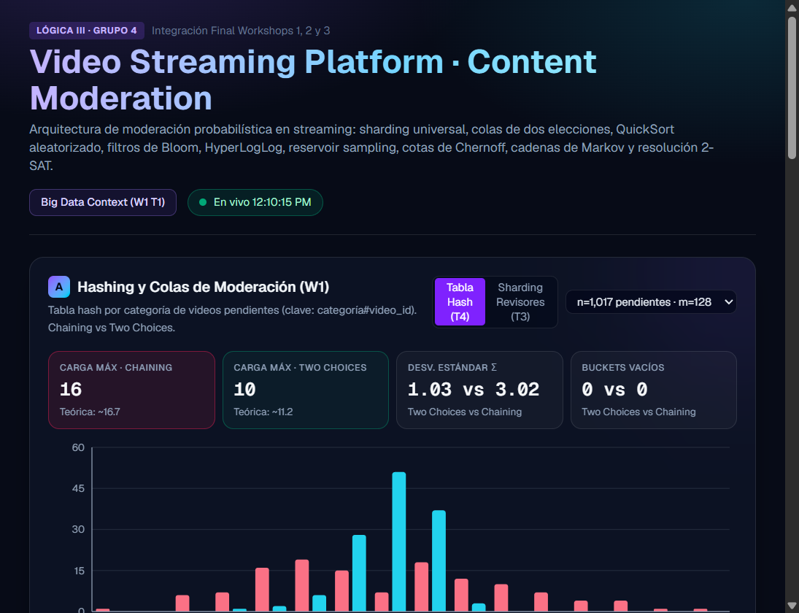
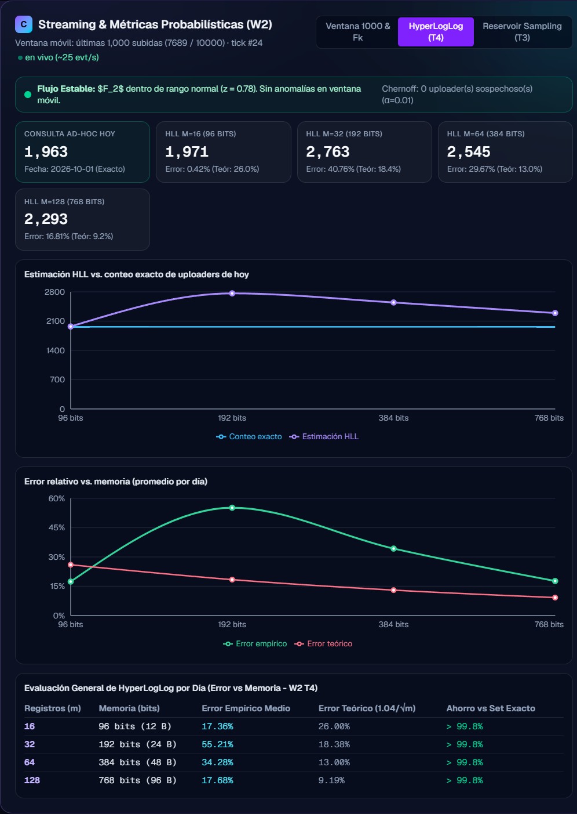

# Informe integrado — Workshops 1, 2 y 3
## Moderación de contenido para una plataforma de streaming de video

**Lógica III · 2026-2 · Equipo 4**
**Autores:** Arley, Juan Camilo y Andrés Buitrago

### Resumen y metodología

Se integraron algoritmos de hashing, ordenamiento aleatorizado, resúmenes probabilísticos de flujos y análisis de grafos en un dashboard. Los resultados usan 10.000 registros de video, 10 categorías y un flujo de 10.000 eventos. Los valores temporales son benchmarks de esta ejecución y pueden cambiar según el equipo. El generador reproducible se encuentra en `backend/generate_data.py`; por defecto usa semilla 42 y escribe los tres JSON del proyecto en `backend/data`.

### Resultados — Workshop 1

**Contexto Big Data.** La muestra cubre aproximadamente un día. La tasa base calculada es **0,116 subidas/s**; al escalar ×10 resulta **1,158 subidas/s**. Con un promedio de **167,35 bytes de metadatos por registro** (sin archivos de video), la proyección es **16,74 MB/día** y **6,11 GB/año**.

**QuickSort.** Se comparó pivote fijo contra pivote aleatorio para entradas originales, ordenadas e inversas, verificando el orden final. En la caché reportada, para n=8.000 en el caso ordenado, la versión aleatorizada fue aproximadamente **253× más rápida**. El resultado ilustra la degradación cuadrática del pivote fijo en entradas adversas; los tiempos dependen de la máquina.

**Sharding y tabla hash.** Se distribuyeron los 10.000 videos entre **32 revisores**: media de 312,5 videos, máximo de 383 y razón máximo/media de 1,23. Para los **1.017 videos marcados** y 128 buckets, Chaining tuvo carga máxima 16 y desviación estándar 3,02; Power of Two Choices redujo esos valores a 10 y 1,03.

**Cota de Chernoff.** Con tasa base 10,17%, umbral 20,34% y α=0,01, se evaluaron 1.121 uploaders con al menos cinco videos. Aunque 140 superaron el umbral observado, ninguno quedó clasificado como sospechoso según la cota; la evidencia disponible no justifica atribuir esas tasas a actividad no aleatoria.

### Resultados — Workshop 2

La consulta permanente calcula la tasa de marcados por categoría en una ventana móvil de 1.000 eventos; la consulta ad hoc compara uploaders distintos del día mediante conteo exacto e HyperLogLog. El Bloom compara falsos positivos experimentales y teóricos para 4, 8, 12 y 16 bits por elemento. Con 8 bits, la caché observó **2,10%** frente a **2,16%** teórico; con 16 bits observó 0% en esta muestra. El panel en vivo recalcula el resultado sobre los eventos consumidos hasta el cursor actual.

El Reservoir Sampling estima `view_count_1h` por categoría: el error medio de 30 corridas fue **15,57%, 8,07% y 6,51%** para k=100, 300 y 500, respectivamente. Para HyperLogLog se muestran memoria, error empírico y teórico para m=16, 32, 64 y 128. El conjunto disponible cubre un solo día y los errores varían sustancialmente (por ejemplo, 17,36% en m=16 y 17,68% en m=128); esta muestra no basta para sostener que el error empírico siempre siga la aproximación teórica. En los momentos exactos sobre todos los videos, F₀=10, F₁=10.000 y F₂=10.005.406; la probabilidad de colisión (0,10005) es cercana al baseline uniforme (0,1). La ventana en vivo alerta cuando el z-score de F₂ o de la tasa supera 2.

### Resultados — Workshop 3

La matriz de transiciones entre las diez categorías produce una cadena irreducible, aperiódica (periodo 1) y sin estados absorbentes. La distribución estacionaria converge en 9 iteraciones (residuo 6,4×10⁻¹⁶); **Videojuegos** es el estado de mayor masa (10,57%), mientras **Deportes** lidera el volumen bruto de subidas. Una caminata lazy de 50.000 pasos tuvo distancia de variación total **0,58%** respecto de π. PageRank usa d=0,85; su correlación de rangos con frecuencia es ρ=0,62. El módulo de Papadimitriou modela cinco cláusulas sobre ocho variables (revisores o limitación para cuatro categorías y una restricción presupuestal); la instancia satisface todas las cláusulas.

### Dashboard y evidencia

El dashboard desplegado integra hashing/sharding (A), runtimes (B), streaming y métricas W2 (C), y PageRank/Markov/2-SAT (D). El panel C permite alternar las vistas de ventana/Fk, HyperLogLog y Reservoir Sampling.

  
  

[Abrir captura completa de los paneles A–D](screenshots/dashboard-full.png).

### Conclusión

La integración demuestra el comportamiento de las técnicas y permite contrastar resultados empíricos con referencias teóricas sobre los datasets del workshop. No es una evaluación de tráfico de producción: el flujo se simula sobre datos locales y los benchmarks son dependientes del entorno. El generador permite reproducir los datasets con una semilla fija y volver a calcular los resultados estáticos.
